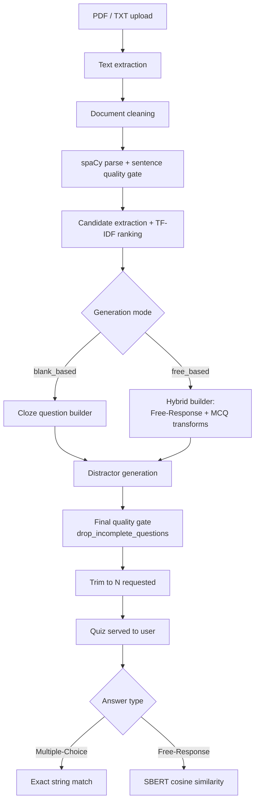

# How the Question Generation Pipeline Works

A step-by-step walkthrough of every algorithm this project runs, in the
order the data actually flows through them: upload → cleaned text →
parsed sentences → answer candidates → questions → distractors →
quality gate → grading. Each section names the file/function that
implements the step, the actual thresholds used, and *why* that
threshold exists (most of them exist to kill a specific failure mode
seen in early output — that history is in the source docstrings and
[IMPROVEMENTS_AR.md](IMPROVEMENTS_AR.md)).

---

## Step 1 — File upload & text extraction

**File:** [workers.py](workers.py) — `pdf2text()`

- `.pdf` → read with `pypdf.PdfReader`, call `page.extract_text()` on
  every page, concatenate with `\n` separators.
- `.txt` → read directly as UTF-8 (`errors='replace'` so a malformed
  byte doesn't crash the upload).

This is a straight extraction — no NLP yet. Raw PDF extraction is
notoriously messy (headers/footers, table-of-contents dot leaders,
hyphenated line-wraps), which is why the very next step exists.

---

## Step 2 — Document cleaning

**File:** [text_cleaning.py](text_cleaning.py) — `clean_document()`

This is a rule-based text-normalisation pass, not a statistical model.
It runs entirely on regex and line-frequency counting:

1. **Unicode normalisation** (`_normalise_unicode`) — NFKC-normalise,
   then map curly quotes/dashes/ligatures to their plain-ASCII
   equivalents (`'`, `"`, `-`, `fi`, `fl`, …).
2. **Rejoin hyphenated line-wraps** — `respons‑\nibility` →
   `responsibility` via the `_HYPHEN_BREAK` regex.
3. **Drop layout furniture, line by line:**
   - **Repeated-line detection** (`_find_repeated_lines`): count every
     line's exact text across the whole document; any line repeated
     ≥ 4 times is a running header/footer (e.g. `YUM! GLOBAL CODE OF
     CONDUCT` on every page) and is dropped everywhere it appears.
   - **Dot-leader lines** (`_DOT_LEADER`): table-of-contents rows like
     `Our Commitment to Integrity......5`.
   - **Bare page numbers** (`_BARE_NUMBER`).
   - **Known furniture patterns** (`_FURNITURE`): "Table of Contents",
     "Page N", bare bullet characters, etc.
   - **Bullet prefixes** are stripped but the bullet's text is kept.
   - **Headings** (`_is_heading`): a short line (≤ 12 words) with no
     terminal punctuation, and either mostly uppercase or ≤ 8 words —
     treated as a title/slogan and turned into a paragraph break
     rather than being glued onto the next sentence.
4. **Re-flow into paragraphs** — consecutive surviving lines are
   joined with spaces into one paragraph; blank lines / headings mark
   paragraph boundaries. Whitespace is then collapsed.

**Why punctuation is preserved:** an earlier version of this pipeline
stripped all punctuation before parsing, which destroyed sentence
boundaries — `"Yum!"` lost its `!` and glued onto the next sentence,
producing stems like `"...to ship supplies from ____ ."`. Cleaning now
never touches sentence-ending punctuation.

### Brand-token protection

**Function:** `register_brand_tokens(nlp, cleaned_text)`

spaCy tokenises `"Yum!"` as two tokens (`Yum`, `!`) and treats the `!`
as a sentence terminator, which fragments any sentence containing the
brand name mid-clause. This function scans the cleaned text for the
pattern `Word!` (`_BRAND_TOKEN`), and for any such token that appears
**≥ 5 times** and is followed by terminal punctuation **less than half**
the time (i.e. it's usually *inside* a sentence, not ending one), it
registers a spaCy tokenizer special case so `"Yum!"` becomes a single
atomic token. This is decided empirically from the document itself —
there's no hard-coded brand list.

---

## Step 3 — NLP model loading

**File:** [nlp_models.py](nlp_models.py) — loaded once at import time,
shared across every request.

| Model | Purpose | Preference order |
|---|---|---|
| spaCy pipeline | tokenisation, POS tags, dependency parse, NER, sentence segmentation | `en_core_web_md` (has word vectors) → falls back to `en_core_web_sm` |
| `SentenceTransformer` (SBERT) | sentence/phrase embeddings for every cosine-similarity comparison in the project | local `./models/all-MiniLM-L6-v2` if present → otherwise pulled from the HuggingFace hub (`sentence-transformers/all-MiniLM-L6-v2`) |

Every later step that needs "does phrase A mean roughly the same thing
as phrase B" uses this one SBERT instance and cosine similarity — it's
the single semantic-similarity primitive the whole system is built on
(distractor filtering, distractor diversification, **and** free-response
grading all reuse it).

---

## Step 4 — Sentence quality gate

**File:** [text_cleaning.py](text_cleaning.py) — `select_quality_sentences()` / `is_quality_sentence()`

The cleaned document is parsed once with spaCy (`nlp(document)`), which
splits it into sentences (`doc.sents`). Not every sentence is fit to
become a question — this is a rule-based filter, evaluated per
sentence:

| Check | Rule |
|---|---|
| Length | `8 ≤ word count ≤ 45` |
| Capitalisation | must start with an uppercase letter |
| Termination | must end in `.`/`!`/`?` (optionally followed by a quote/bracket) |
| Not itself a question | rejected if it ends in `?` (section headings like *"What is the purpose of this Code?"* can't be turned into a question) |
| No cross-references | rejected if it matches `see page`, `refer to page`, `click here`, `table of contents`, etc. |
| Mostly alphabetic | ≥ 90% of non-space characters must be letters/digits/basic punctuation (`_alpha_ratio`) |
| No ALL-CAPS run | rejected if it contains 3+ consecutive all-caps words (banner text) |
| No dangling opener | rejected if the first word is a deictic pronoun/determiner (`this`, `they`, `it`, `such`, …) — the reader couldn't resolve what it refers to |
| No mid-sentence split | rejected if it contains a raw newline, or a `.`/`!`/`?` immediately followed by a lower-case letter (a sign the sentence-boundary detector merged two passages) |
| Real clause | via dependency parse: must contain a subject (`nsubj`/`nsubjpass`/`expl`) **and** a finite verb (a `VERB`/`AUX` token that isn't a gerund) |
| Sensible root | the sentence's dependency root must be a `VERB`, `AUX`, `NOUN`, `PROPN` or `ADJ` |

Sentences are also de-duplicated by their lower-cased text. Everything
that survives this gate becomes the pool the rest of the pipeline works
from — nothing downstream ever sees a sentence that failed here.

---

## Step 5 — Candidate extraction & salience ranking

**File:** [candidate_selection.py](candidate_selection.py)

This step decides *what* the questions will be about — it produces a
ranked list of `Candidate(text, span, sentence, label, score)` phrases
that are good answer keys.

### 5a. Extraction (`extract_candidates`)

Two sources of candidate phrases, both anchored to a specific
quality-gated sentence:

1. **Named entities** (`doc.ents`) whose label is in
   `INFORMATIVE_LABELS` — `PERSON, ORG, GPE, LOC, NORP, FAC, EVENT,
   LAW, PRODUCT, DATE, TIME, MONEY, PERCENT, QUANTITY`. Bare
   `ORDINAL`/`CARDINAL` numbers are excluded — a lone number rarely
   makes a fair question on its own.
2. **Noun chunks** (`doc.noun_chunks`), with any leading
   determiner/pronoun stripped off (so `"the Board of Directors"` →
   `"Board of Directors"`). Chunks whose grammatical root is a pronoun,
   or isn't a `NOUN`/`PROPN`, are discarded.

Every candidate phrase then passes `_is_acceptable_phrase`, which
rejects:
- phrases outside `4–45` characters or `1–5` words,
- phrases with no letters at all,
- phrases ending on a function word (`of`, `in`, `the`, …),
- phrases spanning a coordination (`"Yum! or other companies"` — a
  parse artefact, not something anyone would offer as an answer),
- dangling possessives (`"Law Department's"`),
- unbalanced brackets (`"Employee(s"`),
- phrases where **every** content word is in a hand-curated
  `_VACUOUS_WORDS` set (~90 nouns like `thing`, `matter`, `country`,
  `policy`, `employee` — words that are grammatically fine noun heads
  but test no actual knowledge, e.g. `"A Country"`, `"This Business
  Relationship"`).

Surviving candidates are de-duplicated by their normalised form
(`normalise_phrase`: lower-case, determiner-stripped, punctuation-
stripped).

### 5b. Ranking (`rank_candidates`) — TF-IDF salience

The set of quality sentences is treated as a small corpus:

1. Fit a scikit-learn `TfidfVectorizer(stop_words='english')` over the
   sentence texts.
2. Take the **mean TF-IDF weight of every term across the whole
   corpus** — a proxy for "how much does this word carry the
   document's actual content, as opposed to being common filler."
3. Each candidate's score = the sum of the mean TF-IDF weights of the
   tokens inside its span.
4. **Bonus multipliers:**
   - `× 1.4` if the candidate came from a named entity (a typed answer
     is more likely to be a clean fact than an arbitrary noun chunk),
   - `× 1.15` if the candidate is 2–3 words long (more specific than a
     single word, without being an unwieldy phrase).
5. Sort descending by score.

This score is what later steps iterate over — the highest-salience,
most on-topic candidates are tried first when building questions.

---

## Step 6 — Question generation

The app supports two generation modes, chosen on the upload form
(`generation_method`): **`blank_based`** and **`free_based`**. Both
reuse the exact same Steps 1–5 above; they differ only in how a
ranked candidate becomes a question.

### 6a. Blank-based mode — cloze (fill-in-the-blank)

**File:** [question_extraction.py](question_extraction.py) —
`QuestionExtractor`

This is the simplest and most robust question form: the candidate's
text is blanked out of its own real sentence, so the stem can never be
ungrammatical — it *is* a real sentence, minus one span.

For each ranked candidate, in score order:
1. Skip it if its sentence was already used for another question (one
   question per sentence).
2. Skip it if it's **topically redundant** with an already-chosen
   answer: `is_redundant_with` compares the candidate's
   inflection-normalised content-word set (`content_key`) against
   every previously used one, and rejects it if the overlap ratio
   (`shared / min(len_a, len_b)`) is **≥ 0.5**. This is what stops a
   5-question quiz from being five variations of the company name
   (`"Yum! business"`, `"Yum!'s business"`, `"Yum! employees"`, …).
3. Build the cloze (`build_cloze`): replace the candidate span with
   the literal string `__________` inside the sentence text. Rejected
   if fewer than **2 words** lead the blank, or fewer than **6 words**
   total surround it (a blank with nothing to reason from, e.g. `"____
   brand restaurant in Asia..."`, is unusable). A leaked indefinite
   article immediately before the blank (`"a ____"` when the true
   answer starts with `"the"`) is stripped so it can't give away the
   grammatical number/definiteness of the answer.
4. Record `{question, answer, answer_label}` and move to the next
   candidate until `num_questions` stems exist.

### 6b. Free-based mode — hybrid (Free-Response + Multiple-Choice)

**File:** [hybrid_assessment_system.py](hybrid_assessment_system.py) —
`HybridAssessmentSystem`

This mode builds **one Free-Response question first**, then fills the
rest of the quiz with Multiple-Choice items, preferring genuine
interrogative sentences over cloze and only falling back to cloze if
needed.

#### Free-Response construction

1. **Rank candidate sentences by "obligation strength"**
   (`_obligation_sentences`): every quality sentence is scored by how
   many words from an `_OBLIGATION_MARKERS` list it contains (`must`,
   `shall`, `required`, `responsible`, `prohibited`, `forbidden`, `may
   not`, `should`, …), tie-broken by sentence length. Sentences that
   state a *duty* make the best open-ended questions for a policy
   document.
2. For the top candidate sentence, extract its **grammatical subject
   noun phrase** (`_subject_phrase`): walk `sentence.noun_chunks` for
   one whose dependency root is `nsubj`/`nsubjpass`. Reject a pronoun
   subject (`"they must report it"` — the reader can't resolve
   "they"). `_expand_left` re-attaches proper-noun material spaCy's
   tokeniser otherwise cuts off after an exclamation mark (`"Yum!"`).
3. **Decide the question template** based on:
   - whether the subject is an **actor** (`_denotes_person`: a
     `PERSON`/`NORP` entity, an `ORG`, or one of ~35 hand-listed
     person-referring nouns like `employee`, `director`, `contractor`)
     — a non-actor subject (e.g. a document title) gets a neutral
     `"What does the Code of Conduct set out in relation to X?"` frame
     instead of an agentive one;
   - the sentence's modal verb (`_modal_of`: `must`/`shall`/`should`/
     `may`/`can`/`will`);
   - keyword cues (`prohibited`/`may not` → a prohibition frame,
     `responsible`/`responsibility` → a responsibility frame, else a
     generic requirement frame).
4. **Reference answer** = the sentence's own text, verbatim — this is
   what free-response grading (Step 10b) is compared against later.
5. **Validate** (`is_valid_free_response_question`): 6–30 words, ends
   in `?`, starts uppercase, doesn't end on a dangling connective
   (`"...of ?"`), no immediately-repeated word (a splice artefact).
   If validation fails, the next-best obligation sentence is tried.

#### Multiple-Choice construction (fills the rest of the quiz)

Two passes over the ranked candidates (skipping sentences/topics
already used, via the same `is_redundant_with` check as cloze mode):

- **Pass 1 (`allow_cloze=False`)** — only accept a candidate if a
  genuine interrogative transform applies:
  - **Subject substitution** (`build_subject_question`): applies when
    the candidate *is* the sentence's whole subject noun phrase and
    that subject opens the sentence — then the subject is literally
    replaced with `Who`/`What` (or a more specific WH-phrase like
    `"Which organisation"` for an `ORG` entity, via `_LABEL_TO_WH`).
    Guarded heavily against ungrammatical results: no quoted speech or
    first-person pronouns in the sentence, the candidate must cover
    the *entire* subject chunk, the sentence must be ≥ 10 words with
    ≥ 5 words remaining after the subject, no coordinated subject, no
    colon introducing a list, and singular/plural subject–verb
    agreement is checked so a plural subject isn't replaced in front
    of a verb that only makes sense with `What`/`Who` (singular).
  - **Copular definition** (`build_definition_question`): applies when
    the candidate is the complement of "to be" (`"X is <answer>"`),
    turning it into `"What is X?"`.
- **Pass 2 (`allow_cloze=True`)** — anything left over falls back to
  the identical `build_cloze` logic from Step 6a, so the quiz is never
  short just because not every sentence has a clean subject/copula
  transform.

Both transform outputs are structurally validated by `is_valid_question`
(5–30 words, ends in `?` or contains the blank marker, starts with a
recognised interrogative/auxiliary word, no repeated word, doesn't end
on a dangling preposition).

---

## Step 7 — Distractor (wrong-answer) generation

**File:** [incorrect_answer_generation.py](incorrect_answer_generation.py) —
`IncorrectAnswerGenerator`

Applies to every Multiple-Choice item from either mode. A good
distractor has to sit in a narrow band: not so close to the answer that
it's arguably also correct, not so far that it's eliminated on sight,
and not visually distinguishable by casing/length from the real
answer.

1. **Build a candidate pool** (`_build_pool`): reuse the same vetted
   `Candidate` list from Step 5 (preferred — it's already been through
   the vacuous-word/shape filters) or, if none were passed in, fall
   back to raw 1–4-word entities and noun chunks from the document.
2. **Add WordNet co-hyponyms** (`get_wordnet_candidates`, only for
   answers ≤ 2 words): look up the answer in WordNet, take its
   hypernym(s), and collect *other* words under that same hypernym
   (siblings/co-hyponyms) — e.g. if the answer is a kind of document,
   WordNet supplies other document types as plausible wrong options.
3. **Filter the pool** (`filter_candidates`):
   - **Type match** — if the answer has an entity label, a candidate
     with a *different* label is rejected (a `GPE` answer shouldn't be
     offered against a `DATE` option).
   - **Alias rejection** (`_is_alias`) — rejects anything that likely
     denotes the *same* thing as the answer: exact/substring match,
     acronym match in either direction (`"The Us"` vs `"The United
     States"`), same word-stems after a lightweight suffix-based
     stemmer (`_stem_word`, handles `-ies/-ches/-shes/-sses/-xes/-ves
     /-es/-s`) — catching plural/singular pairs like `"years"` vs
     `"The Year"` — and a shared two-word "head" phrase.
   - **Shape match** (`_shape_matches`) — word-count must be within 2
     of the answer's, character length must be within a `0.4×–2.5×`
     ratio of the answer's, and digit-presence must match (a number
     can only be matched by another number). This is what stops the
     tell-tale case of one one-word option sitting next to a
     four-word answer.
   - Anything already visible **inside the question stem text** is
     excluded — it isn't a real alternative if the reader can see it
     belongs elsewhere in the sentence.
4. **Semantic band filter** (`rank_candidates`) — embed the answer and
   every surviving candidate with SBERT, compute cosine similarity of
   each candidate to the answer, and keep only those with:

   | Bound | Value | Meaning if crossed |
   |---|---|---|
   | `MIN_SIMILARITY` | 0.30 | below this, the option is obviously unrelated → answer given away by elimination |
   | `MAX_SIMILARITY` | 0.78 | above this, the option paraphrases the answer → two defensible correct answers |

   If nothing falls inside the band, the filter relaxes to "similarity
   ≤ `MAX_SIMILARITY`" rather than leaving the question with no
   distractors at all. Survivors are sorted by similarity descending —
   closest to the top of the band first, i.e. most plausible without
   being a paraphrase.
5. **Diversify** (`diversify_candidates`) — greedily walk the ranked
   list and keep a candidate only if:
   - its similarity to every *already-chosen* distractor is
     ≤ `MAX_MUTUAL_SIMILARITY` (**0.82**), and
   - it isn't an alias (`_is_alias`) of an already-chosen one.

   This stops the wrong options from clustering around one
   near-duplicate idea. If diversification leaves too few options, the
   remaining slots are topped up from the ranked (non-diversified)
   list rather than shipping a short option set.
6. **Case matching** (`_match_case`) — only all-lower-case options
   (i.e. WordNet-sourced ones; document-sourced ones already carry
   correct casing) are re-cased to match the answer's casing
   convention, so the option list doesn't visually betray the answer
   through a casing mismatch.
7. **Assemble** — `distractors + [answer]`, `random.shuffle`d, numbered
   `1..n` into the final options dict.

---

## Step 8 — Final quality gate

**File:** [question_processing.py](question_processing.py) —
`drop_incomplete_questions()` / `_is_sound_question()`

A second, independent verification pass runs over *every* generated
question (from either mode) before it's ever shown to a user. Nothing
here tries to repair a broken item — an earlier version padded short
option lists with invented text like `"General company policy"`, which
made every question it touched a free point; the current rule is
**verify, don't repair**:

- question and answer text must both be non-empty,
- question must be ≥ 5 words,
- question must end in terminal punctuation, or contain the blank
  marker,
- **Free-Response**: the reference answer must be ≥ 6 words (a real
  sentence, not a fragment),
- **Multiple-Choice**: must have at least `min_options` options, no
  two options may be duplicates of each other after normalisation,
  exactly one option may match the answer, and the answer text must
  **not** also appear verbatim inside the question stem (which would
  leak it).

Anything that fails is dropped; survivors are renumbered from 1.

---

## Step 9 — Overgeneration & trimming

**File:** [workers.py](workers.py) — `txt2questions()` /
`txt2questions_free()`

Because Step 8 drops a fraction of generated items, both generators are
asked for **`n + 4`** questions (`_OVERGENERATE = 4`) up front, then
the surviving, quality-gated set is trimmed back down to the requested
`n` (`_trim`, keeping the lowest-numbered — i.e. earliest/highest
ranked — survivors). Without the overgeneration margin, a single
rejected item would silently leave the quiz short.

---

## Step 10 — Grading

**File:** [app.py](app.py) `/result` route +
[question_processing.py](question_processing.py) `evaluate_free_response()`

### 10a. Multiple-Choice

Plain exact-match comparison: the submitted option string and the
stored correct answer are both `.strip().casefold()`-ed and compared
for equality. No fuzzy/semantic logic here — the options were already
constructed so exactly one of them equals the answer verbatim.

### 10b. Free-Response — **this is where semantic similarity is used**

1. If the learner left the answer blank → score `0.0`, `Incorrect`.
2. If there's no reference answer to grade against → `Cannot evaluate`.
3. Otherwise: encode **both** the learner's submitted text and the
   reference answer (the original source sentence, from Step 6b) with
   the same SBERT model used everywhere else in the project
   (`semantic_model.encode(..., convert_to_tensor=True)`).
4. Compute cosine similarity between the two embeddings
   (`sentence_transformers.util.cos_sim`).
5. `status = 'Correct' if similarity >= 0.60 else 'Incorrect'`; the
   raw similarity score (0.0–1.0) is also returned and shown to the
   learner.

So free-response grading does **not** do keyword matching or exact
comparison — it checks whether the learner's answer is semantically
close to the source sentence, which is what lets a correctly-paraphrased
answer still pass.

---

## Quick reference — every threshold in the pipeline

| Constant | Value | File | Purpose |
|---|---|---|---|
| `min_repeats` | 4 | text_cleaning.py | lines repeated this often are treated as running headers/footers |
| sentence word count | 8–45 | text_cleaning.py | quality-sentence length bounds |
| alpha ratio | ≥ 0.90 | text_cleaning.py | rejects layout-noise "sentences" |
| brand-token merge | ≥ 5 occurrences, < 50% terminal | text_cleaning.py | when to treat `Word!` as one token |
| candidate phrase | 4–45 chars, 1–5 words | candidate_selection.py | answer-key phrase bounds |
| TF-IDF entity bonus | × 1.4 | candidate_selection.py | named entities score higher than noun chunks |
| TF-IDF length bonus | × 1.15 | candidate_selection.py | 2–3 word phrases score higher |
| redundancy overlap | ≥ 0.5 | candidate_selection.py | topical-duplicate rejection threshold |
| cloze leading words | ≥ 2 | question_extraction.py | minimum words before the blank |
| cloze total context | ≥ 6 words | question_extraction.py | minimum words around the blank |
| free-response length | 6–30 words | hybrid_assessment_system.py | valid question stem length |
| subject-question min sentence | ≥ 10 words | hybrid_assessment_system.py | enough substance to survive subject removal |
| `MIN_SIMILARITY` | 0.30 | incorrect_answer_generation.py | distractor floor — below this, obviously wrong |
| `MAX_SIMILARITY` | 0.78 | incorrect_answer_generation.py | distractor ceiling — above this, a paraphrase |
| `MAX_MUTUAL_SIMILARITY` | 0.82 | incorrect_answer_generation.py | distractors must differ from each other |
| shape-match length ratio | 0.4×–2.5× | incorrect_answer_generation.py | option/answer length can't look mismatched |
| free-response grading threshold | 0.60 cosine similarity | question_processing.py | pass/fail cut-off for semantic grading |
| `_OVERGENERATE` | 4 | workers.py | spare questions requested to survive Step 8's drop rate |

---

## File map

| File | Role |
|---|---|
| [app.py](app.py) | Flask routes: upload, quiz rendering, grading, quiz archive |
| [workers.py](workers.py) | PDF/TXT extraction; top-level `txt2questions` / `txt2questions_free` entry points; overgenerate-and-trim |
| [text_cleaning.py](text_cleaning.py) | PDF furniture removal, paragraph reflow, brand-token protection, sentence quality gate |
| [nlp_models.py](nlp_models.py) | Shared spaCy + SBERT model instances |
| [candidate_selection.py](candidate_selection.py) | Answer-key candidate extraction + TF-IDF salience ranking |
| [question_extraction.py](question_extraction.py) | Cloze (fill-in-the-blank) question builder — blank-based mode |
| [hybrid_assessment_system.py](hybrid_assessment_system.py) | Free-Response builder + interrogative MCQ transforms — free-based mode |
| [incorrect_answer_generation.py](incorrect_answer_generation.py) | Distractor pool, filtering, semantic-band ranking, diversification |
| [question_processing.py](question_processing.py) | Final quality gate (`drop_incomplete_questions`) + free-response grading |
| [generated_quizzes/](generated_quizzes/) | Saved HTML snapshots of past test runs (see `/quiz/archive`) |
